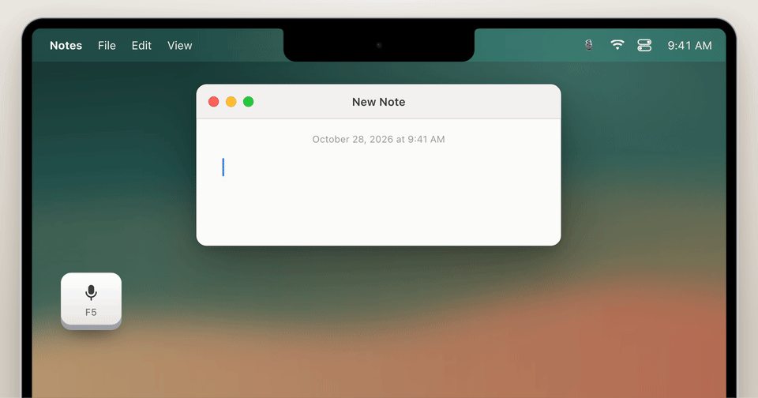

<h1 align="center">Hark</h1>

<p align="center">
  Private dictation for your Mac.<br>
  Press F5, talk, press F5 again. The text is pasted where your cursor is.<br>
  Whisper runs on your Mac. No cloud, no account.
</p>

<p align="center">
  
</p>

<p align="center">
  <a href="https://hark.works/">Website</a> ·
  <a href="https://github.com/bath/hark-stt/releases/latest">Download</a> ·
  <a href="AGENTS.md">AGENTS.md</a>
</p>

## Install

Download `Hark-X.Y.Z.dmg` from the [latest release](https://github.com/bath/hark-stt/releases/latest) and drag Hark to Applications. Or use Homebrew:

```sh
brew install --cask bath/tap/hark
```

Open Hark. Allow the microphone, and turn on Hark in System Settings → Privacy & Security → Accessibility. The first run downloads the Whisper model (574 MB).

Hark needs macOS 14 or later on Apple silicon.

## Use

Click into any text field, press F5 (or ⌥Space), talk, and press it again. Your last transcript stays on the clipboard, so ⌘V pastes it again.

Hark uses Whisper. To use Parakeet (NVIDIA Parakeet TDT 0.6B v2, English only), choose Hark menu → Speech Model → Parakeet. Hark downloads it (464 MB) the first time. It also runs on your Mac, and it is faster.

The Hark icon in the menu bar (a small waveform) has the sound packs, the Notch Island switch and Check for Updates. Hark looks for a new version once a day and tells you in the Notch Island; the update installs in place.

## Uninstall

```sh
brew uninstall --zap --cask hark
```

Without Homebrew, quit Hark and delete `/Applications/Hark.app` and `~/Library/Application Support/Hark`.

## Development

The app is a Swift package in `app/`. [AGENTS.md](AGENTS.md) has the repo layout, tests and release steps.

```sh
cd app
swift test
scripts/build-app.sh   # builds app/build/Hark.app
```

## License

MIT. See [LICENSE](LICENSE).
