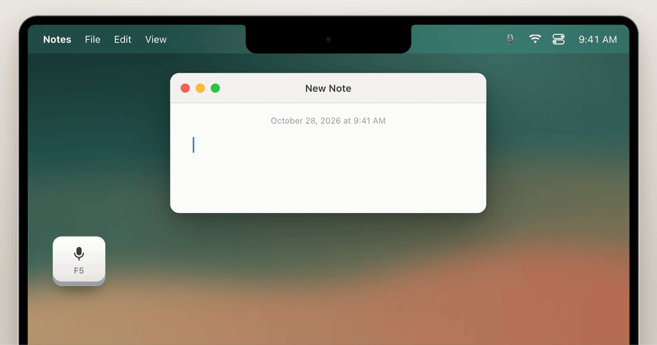
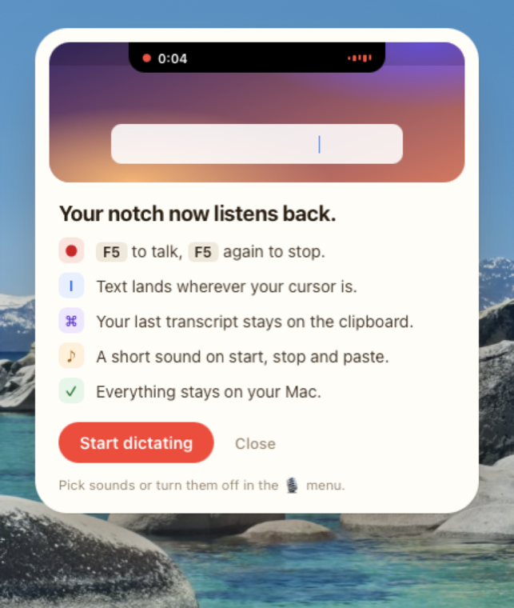
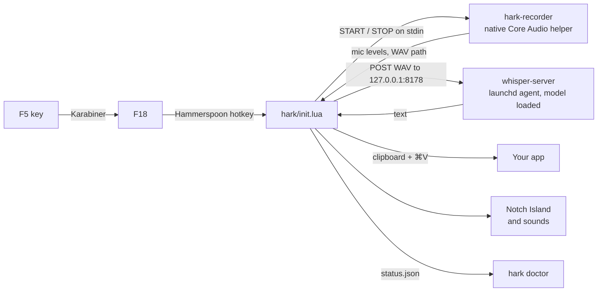

<h1 align="center">Hark</h1>

<p align="center">
  Better, private dictation for your Mac.<br>
  Press F5, talk, press F5 again. Your words are typed into whatever app you are in.<br>
  Whisper runs on your Mac. No cloud, no account, no telemetry.
</p>

<p align="center">
  
  
  
  
  
</p>

<p align="center">
  
</p>

<p align="center">
  <a href="https://hark.works/">Website</a> ·
  <a href="AGENTS.md">AGENTS.md</a> ·
  <a href="llms.txt">llms.txt</a>
</p>

## Install

**Hark.app.** The native app needs no Homebrew, Hammerspoon or Karabiner: download it from the [latest release](https://github.com/bath/hark-stt/releases/latest) (the `Hark-X.Y.Z.dmg` file), or run `brew install --cask bath/tap/hark`. Open it, click Allow for the microphone, and turn on Hark in System Settings → Privacy & Security → Accessibility. It downloads the Whisper model by itself, maps F5 itself, and moves an existing Hammerspoon install over with its settings. Check it with `/Applications/Hark.app/Contents/MacOS/Hark doctor`. The app comes with the first signed release; until a release has the disk image, use the Hammerspoon version below.

**With your AI agent.** Paste this into Claude Code, Codex, Cursor or another coding agent:

```text
Install Hark (https://hark.works) on this Mac. Read https://hark.works/AGENTS.md and follow it step by step.
```

The agent installs Hark.app when a release has it, and otherwise runs the installer. Then it runs `hark doctor --json` until every check passes. When macOS needs you, the agent opens the right System Settings pane and tells you what to turn on.

**The Hammerspoon version, yourself.** You need [Homebrew](https://brew.sh) and the Apple Command Line Tools (`xcode-select --install`).

```sh
curl -fsSL https://hark.works/install.sh | bash
```

**With Homebrew.** This puts `hark` on your PATH, and `brew upgrade` finds new releases.

```sh
brew install bath/tap/hark
hark setup
```

`brew install` cannot write to your home folder, so `hark setup` runs the installer from the formula.

## Why Hark

The dictation built into macOS mishears words, and you cannot tell where your voice goes. Hark is better in the three ways that matter:

1. **Private.** Your voice never leaves your Mac. Not to Apple, not to us, not to anyone. No account, no telemetry, and the code is open.
2. **Accurate.** Whisper large-v3-turbo writes full sentences with punctuation and capital letters, and handles names, technical words and long, fast speech.
3. **Fast.** The model stays loaded, so there is no wait. On an M5 Pro, 15 seconds of speech becomes text in about 0.3 s, and the mic starts about 63 ms after F5.

## What you get

- **Dictation in any text field.** Mail, Slack, your editor, a browser form. The text is pasted where your cursor is.
- **Whisper large-v3-turbo on your own machine.** [whisper.cpp](https://github.com/ggerganov/whisper.cpp) keeps the model loaded in a local server, so there is no startup wait per dictation.
- **Nothing leaves the Mac.** Your audio and text go only to `127.0.0.1`. The installer downloads the model once from Hugging Face. Hark goes to GitHub only when you click Check for Updates.
- **The mic is off until you press F5.** A small native helper keeps the audio input ready but stopped, and releases the mic as soon as you stop talking. The orange mic dot in the menu bar shows only during a take.
- **Notch Island.** The MacBook notch grows into a black pill while you talk. It shows a red dot, a timer and voice bars that follow your voice. Then it shows "Transcribing", then a green check and "Pasted". On a screen with no notch, the pill drops from the top center. It opens on the screen that has your mouse pointer.
- **Sounds for each step.** 26 sound packs, each with a sound for start, stop, pasted and error. Pick one, or turn sounds off, in the 🎙 menu.
- **Your last transcript stays on the clipboard.** If the paste landed in the wrong place, press ⌘V.
- **A setup check that agents can read.** `hark doctor` checks every part of the install. With `--json`, each failed check says whether a person must act and gives the command that opens the right place.

## Set up

The installer:

1. Installs `whisper.cpp`, [Hammerspoon](https://www.hammerspoon.org) and [Karabiner-Elements](https://karabiner-elements.pqrs.org) with Homebrew.
2. Downloads the Whisper model (about 550 MB) to `~/.cache/whisper`.
3. Builds the native recorder helper and the sound library into `~/.hammerspoon/hark`.
4. Starts `whisper-server` as a launchd agent, so it stays up across crashes and reboots.
5. Copies the Karabiner rule into place and runs `hark doctor`.

| Option | What it does |
|---|---|
| `--no-karabiner` | Skips Karabiner-Elements. You dictate with ⌥Space instead of F5. |
| `--json` | Prints only the final `hark doctor --json` report on stdout. Progress goes to stderr. |

Pass options after `bash -s --`, for example `curl -fsSL …/install.sh | bash -s -- --no-karabiner`. Running the installer again is safe. It also moves an old `whisper-dictation` install to the Hark names.

### What macOS needs from you

1. **System Settings → Privacy & Security.** Turn on Hammerspoon under Microphone and under Accessibility.
2. **Karabiner-Elements** (the installer opens it). Approve its driver and Input Monitoring. Then go to Settings → Complex Modifications → Add rule, and turn on "F5 / Dictation key → F18". Installing the rule file does not turn it on.
3. *Optional.* System Settings → Keyboard → Dictation → Off, so Apple's dictation does not also start on that key.

`⌥Space` also toggles dictation. That shortcut needs only step 1. Karabiner is there only because macOS sends the dictation key as a special event that Hammerspoon cannot catch.

### Check the setup

```sh
~/.hammerspoon/hark/bin/hark doctor          # a list with ✓ and ✗, and the fix for each ✗
~/.hammerspoon/hark/bin/hark doctor --json   # the same report for scripts and agents
~/.hammerspoon/hark/bin/hark open-settings accessibility   # or microphone, input-monitoring, karabiner, dictation
```

## Use it

Wait for the menu-bar icon to change from ⏳ to 🎙. Click into any text field, press **F5**, talk, and press **F5** again. The text is pasted shortly after you stop.

The first press after you install or update shows a short welcome card. Press F5 again, or click "Start dictating", to start your first take.

<p align="center">
  
</p>

### The 🎙 menu

| Item | What it does |
|---|---|
| Notch Island | Turns the animation on or off. |
| Sound | Picks a sound pack, sets the volume, or turns sounds off. Picking a pack plays it. |
| Preview animation and sounds | Plays a fake 3-second dictation. Nothing is recorded or pasted. |
| Show welcome screen | Shows the welcome card again. |
| Check for Updates… | Asks GitHub for the latest release. If there is a newer one, click Update. Hammerspoon restarts at the end, and an alert shows the new version. |

### Sound packs

`sounds/generate.py` makes 23 packs at install time with only the Python standard library. Three more packs use the sounds that ship with macOS.

| Pack | Sound |
|---|---|
| Pop (default) | Round bubble pops that bend up to start and down to stop. |
| Soft Bell | A clear bell to start, a lower bell to stop, a small chime when the text lands. |
| Pluck | Two plucked string notes, up to start and down to stop. |
| Whoosh | Soft air that rises to start and falls to stop. |
| Shimmer | A fast four-note arpeggio with a light echo. |
| Tape Deck | The clunk of a record button. |
| Power Up | A short retro synth rise and fall. |
| Sonar | A ping with a long echo. |
| Marimba | Wooden mallet notes. |
| Glass | Small tinkles, like tapping a wine glass. |
| Droplet | Water drops. |
| Typewriter | A key strike, the carriage, and the bell when the text lands. |
| Kalimba | Thumb-piano notes. |
| Blip | Tiny pure tones. The most neutral choice. |
| Wood Block | Hollow wooden knocks. |
| Harp | A quick harp sweep. |
| Cosmic | Sci-fi sweeps with a little wobble. |
| Electric Piano | Soft rolled chords. |
| Arcade | 8-bit chiptune. The pasted sound is a coin. |
| Soft Thump | Low thumps you feel more than hear. |
| Chirp | Quick bird-like chirps. |
| Singing Bowl | A calm bowl with a long ring. |
| Faint Click | A faint tick at each step. |
| macOS Classic, Bright, Deep | Built-in Mac sounds such as Tink, Pop, Glass and Hero. |

## How it works



1. When Hammerspoon loads, the native helper prepares a stopped Core Audio input unit, and launchd keeps `whisper-server` running with the model in memory.
2. F5 starts the input unit. The helper sends mic levels about 30 times a second, and the island uses them to draw the voice bars.
3. The second F5 stops the input unit and releases the mic. The helper writes a temporary WAV file.
4. Hammerspoon sends the WAV to the local server, puts the text on the clipboard, and presses ⌘V.

The Hammerspoon module never starts the server itself. It polls `/health`, reconnects when launchd brings the server back, and shows ⏳ while it waits. Every 5 seconds it writes `~/.hammerspoon/hark/status.json`, which `hark doctor` reads.

### Files

| Installed at | What it is |
|---|---|
| `~/.hammerspoon/hark/` | The module (`init.lua`), the recorder, the sounds, the `hark` CLI and `status.json`. |
| `~/.hammerspoon/init.lua` | One line, `require("hark")`, loads it. |
| `~/Library/LaunchAgents/com.hark-stt.server.plist` | Keeps `whisper-server` running. Log: `/tmp/hark-server.log`. |
| `~/.config/karabiner/assets/complex_modifications/hark.json` | The F5 → F18 rule. |
| `~/.cache/whisper/ggml-large-v3-turbo-q5_0.bin` | The model. |

## Customize

Edit the config block at the top of `~/.hammerspoon/hark/init.lua`, then reload Hammerspoon from the 🎙 menu.

| Setting | Default | Notes |
|---|---|---|
| `MIC` | `nil` | `nil` uses the Mac's built-in mic. Set an exact device name such as `":Studio Display Microphone"` to use another one. |
| `LANG` | `"en"` | Or `"auto"`. |
| `HOTKEYS` | `{{}, "f18"}`, `{{"alt"}, "space"}` | Add or replace toggle hotkeys. |

To change the Whisper model or other server flags, edit `~/Library/LaunchAgents/com.hark-stt.server.plist` and restart the agent with `launchctl kickstart -k gui/$(id -u)/com.hark-stt.server`. Or run `install.sh` again.

## FAQ

**How is this different from Apple Dictation?** It is more private, more accurate and faster (see [Why Hark](#why-hark)). Your voice never leaves your Mac, Whisper large-v3-turbo gets more words right, and the text arrives about 0.3 s after you stop. It also works with the same key in every app, and never needs a network connection after install, except to check for updates when you ask. You can turn Apple Dictation off (step 3 above) so the two do not conflict.

**Does it type while I talk?** No. Whisper gets the whole take after you stop, so the text arrives in one paste.

**Can I use another model?** Yes. Download any whisper.cpp `ggml` model and point the LaunchAgent's `-m` flag at it. Smaller models are faster and less accurate.

**Will the start sound end up in my transcript?** The start sound plays while the mic opens, so the mic can hear it. The start sounds are short (Pop is 140 ms) for this reason. If you see it in your text, pick a quieter pack or turn sounds off.

**Can my agent install it without me?** Almost. macOS requires a person to grant Microphone and Accessibility permission, and to approve Karabiner's driver. The agent opens each pane and tells you what to turn on. Everything else is automatic.

**Intel Mac?** The paths assume Apple-silicon Homebrew (`/opt/homebrew`). On Intel, change them to `/usr/local`.

**Why the name?** "Hark" is an old word for "listen". The repo is `hark-stt` because Hark is speech-to-text.

## Troubleshooting

Run `~/.hammerspoon/hark/bin/hark doctor` first. It names the part that is broken and how to fix it.

- **F5 asks whether you want to turn on Apple's Dictation.** The Karabiner rule is installed but not turned on. In Karabiner-Elements, open Complex Modifications → Add rule and turn on "F5 / Dictation key → F18".
- **F5 does nothing.** Try `⌥Space`. If that works, check the Karabiner rule and its Input Monitoring permission. If it does not, turn on Hammerspoon under Microphone and Accessibility, then reload its config from the menu-bar icon.
- **The first F5 press shows a Microphone prompt.** Approve it, wait for 🎙, then press F5 again. macOS can wait to show this prompt until the helper first starts the input hardware.
- **The menu stays at ⏳.** The recorder or the Whisper server did not start. Recorder errors are in the Hammerspoon Console, and server errors are in `/tmp/hark-server.log`. launchd restarts the server, and dictation reconnects without a reload.
- **No sounds.** Check the volume in the Sound menu. If the menu says "No sounds installed", run `install.sh` again.

## Limits

- Text arrives after you stop, not word by word.
- The helper keeps its input unit initialized but stopped, with a 64-frame buffer. On an M5 Pro, the first audio buffer arrived 63 ms after F5 (median of 30 runs, 75 ms p95). Most of that time is macOS starting the mic hardware. Other Macs and external microphones vary.
- A mic that is fully off cannot record before F5. Anything you say during the short start-up window after the key press is lost. In normal use, that window was shorter than the time it takes to start speaking.
- The helper picks the built-in mic by name, so an iPhone Continuity mic cannot take over because it appears first in the device list.
- A few secure fields block programmatic paste. The transcript is still on the clipboard.

## Development

See [AGENTS.md](AGENTS.md) for the repo layout and rules. The shell tests:

```sh
bash tests/install-streaming.sh   # installer, with Homebrew, curl and launchctl mocked
bash tests/hark-cli.sh            # doctor report, uninstall safety
```

The Lua tests run inside Hammerspoon with a fake `hs` object, so they do not touch your live setup. Run each one from the Hammerspoon Console, or with `hs -c "dofile('…')"`:

```lua
dofile("/path/to/hark-stt/tests/cold-microphone-hot-path.lua")
dofile("/path/to/hark-stt/tests/server-recovery.lua")
dofile("/path/to/hark-stt/tests/notch-island-sounds.lua")
dofile("/path/to/hark-stt/tests/onboarding.lua")
```

## Update

In the 🎙 menu, click **Check for Updates…**. Or run:

```sh
~/.hammerspoon/hark/bin/hark update   # or `hark update` if you installed with Homebrew
```

For a Homebrew install, `hark update` runs `brew upgrade hark` and then `hark setup`. For a curl install, it runs the latest installer from hark.works. It keeps your choice of F5 or ⌥Space. If you run only `brew upgrade hark`, run `hark setup` after it. Until you do, `hark doctor` shows the `hark_current` check as failed.

Hark 1.0.0 has no `update` command, and Hark 1.1.0 has no menu item. To update from those versions, run the installer again or run `hark update` (1.1.0).

## Uninstall

```sh
~/.hammerspoon/hark/bin/hark uninstall --yes
```

This removes `~/.hammerspoon/hark`, the LaunchAgent, the Karabiner rule file and the `require("hark")` line. It keeps the Homebrew apps and the model, and prints the commands to remove those too. For a Homebrew install, also run `brew uninstall hark`.

## License

MIT. See [LICENSE](LICENSE).
